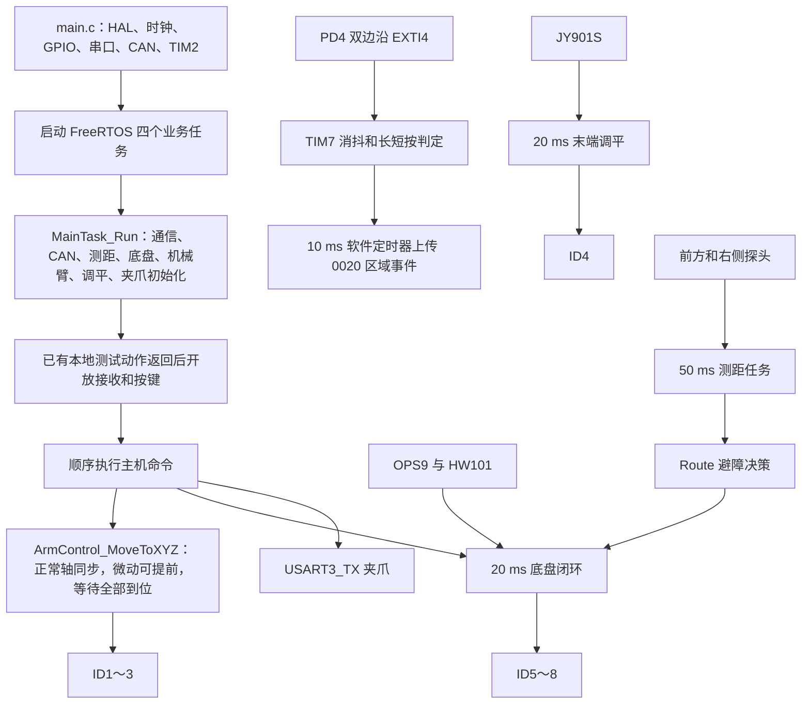

# 工程文件与功能说明

更新日期：2026-10-26。本文对应按《工程代码规范.docx》重构后的工程，包含 PD4 一键启动和机械臂同步点位规划及微动例外。

## 1. 工程做什么

本工程运行在 STM32F407ZET6 上，控制三轴机械臂、末端调平电机、麦克纳姆底盘和串口夹爪。主机通过 USART6 发送动作，主任务依次执行；调平、底盘闭环和超声波采集由各自周期任务持续运行。保留九节点地图的扫描、最短路、遇障停车回退和重新规划功能。

电机分工：ID1～3 为机械臂位置轴，ID4 为末端调平，ID5～8 为底盘。位置、电机方向、机械尺寸及原跑图节点顺序沿用重构前配置。

## 2. 目录结构和职责

业务代码固定为 17 对 `.c/.h`，合计 34 个文件。`.c` 实现行为，`.h` 声明调用接口、数据类型和需要集中修改的参数。

```text
BSP/   claw  hcsr04  hw101  jy901s  ops9
Fun/   X_V2  zdt_can  arm_kinematics  arm_control
       chassis_mecanum  chassis_control  TX_RX  Route
Task/  arm_end_level_task  chassis_task  ultrasonic_task  main_task
```

### BSP：外设驱动

| 文件对 | 具体职责 | 对外使用方法 |
|---|---|---|
| `claw.c/.h` | FashionStar 0x08 单圈角度控制，0.1° 编码，时间字段为 0（极速模式） | `Claw_SetAngle(angle)` |
| `hcsr04.c/.h` | TIM2 计时、TRIG 触发、ECHO 双边沿捕获、超时及距离状态 | 由测距任务调用 `Init/Start/Poll`；中断调用 `OnEcho` |
| `hw101.c/.h` | 接收和校验 HW101 数据，保存航向角及帧时间 | `HW101_GetData()` |
| `jy901s.c/.h` | 解析 JY901S 加速度、角速度、姿态，检查数据新鲜度 | `JY901S_ReadData()` |
| `ops9.c/.h` | 解析 OPS9 定位帧，拒绝非法数据，原子复制定位快照 | `OPS9_GetLatest()` |

### Fun：功能实现

| 文件对 | 具体职责 | 主要入口 |
|---|---|---|
| `X_V2.c/.h` | 电机 X 固件协议校验、组包和发送 | `X_V2_*` |
| `zdt_can.c/.h` | CAN 过滤、完整命令发送互斥、接收队列和错误统计 | `ZDT_CAN_Init()`、`can_SendCmd()` |
| `arm_kinematics.c/.h` | 机械臂几何模型、正逆解、臂长和关节限位 | `ArmIk_SolveBranch()`、`ArmIk_Forward()` |
| `arm_control.c/.h` | 电机映射、正常轴同步、微动可提前到位的点位规划、显式定时/曲线控制、到位和故障处理 | `ArmControl_Init()`、`ArmControl_MoveToXYZ()`、`ArmControl_MoveToXYZTimed()` |
| `chassis_mecanum.c/.h` | 轮径、轴距、轮距、传动比及四轮速度解算 | `ChassisMecanum_SolveVelocity()` |
| `chassis_control.c/.h` | 底盘位置/航向闭环、普通/斜向相对动作、同步直线转向、静止保持、失联恢复 | `ChassisControl_MoveRelativeSequential()`、`ChassisControl_MoveDiagonalRelative()`、`ChassisControl_MoveRelativeStraightTurn()` |
| `TX_RX.c/.h` | 主机 12 字节协议、CRC、循环 DMA 解析、命令队列、启动事件及完成/错误应答；互斥发送完整帧 | `TX_RX_Init()`、`TX_RX_PopCommand()`、`TX_RX_SendStart()`、`TX_RX_SendCompletion()`、`TX_RX_SendArmError()` |
| `Route.c/.h` | 九节点地图、最短路、探头扫描、行进中遇障和回退改路 | `Route_Run()` |

机械臂映射、轨迹数学和执行流程已经合并到 `arm_control`；底盘参数合并到 `chassis_control.h`；地图与导航合并到 `Route`。业务入口不再逐层调用旧任务包装。

### Task：周期任务与主入口

| 文件对 | 周期 | 优先级 | 栈 | 职责 |
|---|---:|---|---:|---|
| `arm_end_level_task.c/.h` | 20 ms | High | 4096 B | 新写的姿态有效性检查、俯仰 PID、末端发令和异常停止 |
| `chassis_task.c/.h` | 20 ms | AboveNormal | 4096 B | 读取定位、运行闭环、更新四轮速度和处理发送故障 |
| `ultrasonic_task.c/.h` | 50 ms | Normal | 2048 B | 按硬件允许间隔采集两路距离，发布状态/时间戳/序号 |
| `main_task.c/.h` | 按动作执行；空闲等待 5 ms | Low | 4096 B | 统一初始化，顺序执行主机命令；保存 PD4 按键状态与启动事件，可调用跑图测试 |

表中是四个业务任务。FreeRTOS 自带空闲任务和软件定时器服务；TX_RX 的接收恢复使用 50 ms 软件定时器，启动事件发送使用 10 ms 软件定时器。按键边沿由 EXTI4 记录，消抖和长按判定由 TIM7 每 5 ms 推进，没有新增业务任务。

## 3. 启动和运行关系



主任务的模块初始化顺序是：通信接收 → CAN → 超声波 → 底盘 → 机械臂 → 调平 → 夹爪。各模块返回初始化结果，失败项记录在 `main_task_init_faults`。当前源码已有的本地底盘测试动作返回后才开放命令接收和按键；初始化期间的命令与按键不积压执行。按键启用还要求通信初始化成功。

`ArmControl_Init()` 保留原来上电前人工摆放机械零位的约定，不做自动寻找机械零点。`ArmEndLevelTask_WaitReady()` 只等待连续有效姿态帧，当前上限 3000 ms；它不执行机械臂动作。

## 4. 机械臂点位与调平

```c
ArmControlStatus status;
status = ArmControl_MoveToXYZ(x_mm, y_mm, z_mm);
if (status == ARM_CONTROL_OK)
{
    /* 本次动作已收到参与运动轴的实际到位反馈。 */
}
```

XYZ 为机械臂基坐标系绝对坐标，单位毫米。上位机 0002 与上述本地接口都直接调用 `ArmControl_MoveToXYZ(x, y, z)`，不传动作时间。内部先逆解、检查目标关节限位、映射电机坐标，再按驱动器实际分辨率计算位移，分别规划三个电机的最快合法运动。

| 参数 | ID1 | ID2 | ID3 |
|---|---:|---:|---:|
| 最大速度 RPM | 2500 | 1800 | 2500 |
| 最大加速度 RPM/s | 600 | 300 | 400 |
| 最大减速度 RPM/s | 700 | 400 | 500 |

规划先按驱动器 0.1° 电机轴位置分辨率计算实际行程；只跳过量化后没有变化的轴。每轴用配置的加减速度上限和不超过速度上限的最大 0.1 RPM 编码，计算最快的三角形/梯形运动时间，取最长时间作为共同时间起点 `T0`。没有固定 2 s 或最小动作时长。

**正常轴同时启动、同步到位。** 调整较快轴的速度，必要时调整加减速度，使参与同步的轴预计到位时间最大差不超过 10 ms。速度取整后会反求减速度的相邻整数编码，减小量化误差；仍无法对齐时，按最近的较晚候选修正共同时间，最多尝试 64 次。速度和加减速度始终不超过上述上限；不能得到合法同步方案时返回错误，不发送失去同步的正常轴动作。该搜索优先使用短时间方案，不声称对所有离散参数组合做全局穷举。

**小位移可以提前到位。** 对某个运动轴，若按当前加减速度上限，即使把速度降至最低 0.1 RPM，预计用时仍小于 `T0 - 0.01 s`，则标为本次微动轴。此处判断的是电机轴行程相对本次共同时间的大小，没有设置固定 XYZ 毫米死区。微动分类在 `T0` 时确定，后续时间修正不能把普通轴变为微动轴。微动轴使用最快合法参数，不参与同步时间搜索；仍与其他轴同组启动、完整执行，并等待实际到位反馈。

`ArmControl_GetLastResult()->profile` 可查看 `predicted_time_s[3]`（各轴预计到位时间）、`planned_time_s`（最慢轴时间）、`vel_rpm[3]`、加减速参数和 `small_move_mask`（bit0/1/2 对应电机 1/2/3；置 1 表示该轴豁免同步）。同步误差为规划模型值，实际到位差受机械负载和驱动器影响，需要实物验证；点位接口不保证末端沿直线运动。

纯模型验证示例：`(0,300,260) → (0,300,261)` 约 0.068125 s；`(-10,400,100) → (-10,400,120)` 约 0.198494 s。这些是代码规划值，未进行实物计时。

到位采用驱动器 `FD 9F` 反馈，规划时间只用来计算等待上限。超时会停止并尝试用实际位置恢复下一次起点；不能确认位置时不继续接受 XYZ 动作。零位移不发送零速位置指令。

`ArmControl_MoveToXYZ()`、不传时间的关节点位和关节偏移接口使用正常轴同步、微动轴可提前到位的自动规划。贝塞尔曲线继续按其曲线参考时间运行；显式 `ArmControl_MoveToXYZTimed()` 使用严格指定同步时长，仅供本地明确需要定时的调用，上位机 0002 不调用它。该显式接口的 0、负数及非有限时间返回 `ARM_CONTROL_TIME_INVALID`；指定时间无法满足速度、加减速、量化或 10 ms 同步约束时返回 `ARM_CONTROL_TIME_UNACHIEVABLE`。

末端 ID4 的调平独立运行，保留 PID：KP=3、KI=0.08、KD=0.15。积分限幅 `ARM_PID_MOTOR_INTEGRAL_LIMIT_DEG_S=10` 的单位是“度·秒”，限制累计角度误差的积分量。该任务只控制安装方向对应的俯仰轴，不具备多轴姿态调平能力。姿态过期、数据无效或发送失败时停止末端输出；主任务在姿态未准备好或末端故障时拒绝新的主机 XYZ 命令。

## 5. 底盘控制和保持

```c
/* 调用时车体坐标：+X 向右，+Y 向前，正转角逆时针。 */
ChassisControl_MoveRelativeSequential(100, 0, 90, 1000, 1500, 3000);
ChassisControl_MoveRelativeStraightTurn(100, 0, 90, 1000, 1500, 3000);
```

前三项是毫米、毫米、度，后三项是电机 RPM/s、RPM/s、RPM。第一种先平移，进入过渡距离后边平移边旋转；第二种从起步开始沿固定直线平移并同时旋转。两个接口均阻塞等待实际到位，底盘任务继续每 20 ms 执行。

斜向移动使用 `ChassisControl_MoveDiagonalRelative(dx,dy,dyaw,acc,dec,max)`。两种指令坐标系都以发令时的车身为基准：普通模式 +X 向右、+Y 向前；斜向模式将两轴整体向右（顺时针）旋转 45°，新 +Y 指向车右前方，新 +X 指向车右后方。坐标轴仍然垂直，位移长度保持不变，dyaw 仍表示真实车身的相对转角。

```c
/* 斜向坐标换算成发令时车体坐标，再复用普通顺序动作。 */
body_x = 0.70710678f * dx + 0.70710678f * dy;
body_y = 0.70710678f * dy - 0.70710678f * dx;

/* 行驶段沿车右前方走 100 mm；到作业区再按车前方向微调 50 mm。 */
if (!ChassisControl_MoveDiagonalRelative(0, 100, 0, 100, 150, 800) ||
    !ChassisControl_MoveRelativeSequential(0, 50, 0, 100, 150, 800))
{
    ++main_task_command_errors;
}
```

例如斜向 Y=100 对应车右约 70.71 mm、车前约 70.71 mm；斜向 X=100 对应车右约 70.71 mm、车后约 70.71 mm。下一条指令重新采用当时的车身方向，本次终点一旦生成，就固定在定位坐标系中；执行过程中的车身转向不会让终点跟着变化。dyaw=0 保持发令时航向，不额外旋转车身。

本地通过选择函数区分两种动作，上位机通过每条命令的 MODE 区分。不存在需要记住或手动恢复的全局坐标模式。普通和斜向移动共用 PID、过渡控制、速度限制、到位判断及传感器异常恢复，原 `Route` 调用继续使用普通车体坐标。

在当前轮速解算下，仅沿新坐标单独一个轴平移且没有转向/纠偏输出时，理想情况下只有一对轮输出非零转速；沿新 +Y 时为 ID6/ID8，沿新 +X 时为 ID5/ID7。其余轮保持使能，允许参与纠偏；X/Y 同时给值或边走边转时可能四轮都参与。能否降低横向振动需要实车对比，坐标转换本身不保证减振。

### 5.1 公共 PID 与运动限制

底盘各反馈环只使用 `Fun/chassis_control.h` 顶部的一组参数：

| 参数 | 默认值 | 含义 |
|---|---:|---|
| `CHASSIS_KP` | 1.5 | 比例系数，1/s |
| `CHASSIS_KI` | 0 | 积分系数，1/s²；0 表示关闭积分 |
| `CHASSIS_KD` | 0.015 | 实测速度阻尼系数，无量纲 |
| `CHASSIS_ACC_MAX_RPM_S` | 1000 | 电机加速度上限，RPM/s |
| `CHASSIS_DEC_MAX_RPM_S` | 1500 | 电机减速度上限，RPM/s |
| `CHASSIS_SPEED_MAX_RPM` | 3000 | 电机速度上限，RPM |

主动转向、行走航向纠偏、横向纠偏、XY 保持、普通位置控制及同步直线转向中的反馈计算均读取公共 PID。各轴分别保存积分输出，XY 两个方向也独立；同一周期的 XY 计算不会重复累积同一个积分。顺序动作沿路径前进按公共 P 与位置误差生成目标速度，再应用车体限速和轮速加减速限制；进入过渡距离后，XY 控制接续当前平移指令，同时开始转向最终航向，不再因为进入过渡范围而把平移目标速度归零。

KI=0 时清零且不累积积分；KI>0 时按误差与真实控制周期积分。积分受对应输出上限限制；车体限速、四轮限速或加减速约束生效时，本周期增大的积分被撤销，减小已有积分的更新保留。传感器数据过期时暂停积分，新动作、停车、故障及传感器暂停/恢复时清理积分。进入动作完成状态后继续保持位置，XY 积分保留，主动转向积分交接给航向保持环。

车体加减速由底盘几何尺寸、传动比及公共 RPM/s 限制换算。现有车体速度保护上限继续生效，不能把 RPM 数值直接当成 mm/s 或 deg/s。动作调用传入的加减速和最大 RPM 是本次动作设定，受公共限制约束；上位机与跑图原有的 100/150/800 设定仍保留。纠偏与最终轮速也受公共电机侧限制约束。

### 5.2 顺序动作的阶段切换与最终精度

`ChassisControl_MoveRelativeSequential()`、其非阻塞入口 `ChassisControl_StartRelativeSequential()` 和斜向接口 `ChassisControl_MoveDiagonalRelative()` 均使用以下两级位置判定。阈值是 XY 平面距离，即 `sqrt(error_x² + error_y²)`，不是每个坐标轴分别允许同样的误差。

| 用途 | 参数宏 |
|---|---|
| 开始边平移边旋转的 XY 距离 | `CHASSIS_SEQUENCE_TRANSLATE_TOLERANCE_MM` |
| 整个动作最终位置到位 | `CHASSIS_SEQUENCE_POSITION_TOLERANCE_MM` |
| 整个动作最终航向到位 | `CHASSIS_SEQUENCE_YAW_TOLERANCE_DEG` |

数值统一以 `Fun/chassis_control.h` 为准，过渡距离与最终位置、航向精度分别设置。

新鲜的 OPS9/HW101 数据确认 XY 平面距离进入过渡范围后，立即开始转向，不再等待实测平移速度、平移轮速降低，也不再累计过渡停稳次数。过渡距离大于整段位移时，动作开始后即可同时平移、旋转；它不限制最终到位精度。

切换时从上一周期最终轮速指令恢复平移及转动分量，把平移交给固定坐标系的 XY 控制、把转动交给转向控制，再清除旧的平移分量，避免速度重置或重复叠加。横向积分按路径法向转换给 XY 环，原航向积分交给转向环。原 XY 终点保持不变，随车体转向持续换算轮速，继续收敛剩余位置和角度误差。

最终仍要求 XY 距离和航向误差分别满足原有精度参数，实测 X/Y 速度不超过 20 mm/s、角速度不超过 2°/s、最终四轮指令不超过 2 RPM，并连续 3 次有效新采样达标，才判定动作完成并允许发送 0011。重复读取同一帧不会增加到位计数。纯平移和原地旋转也经过相同的最终完成判断。

这次取消的是过渡处的强制停车；靠近最终终点时，PID 仍会降低目标速度，原有轮速上限、加减速限制和饱和分配继续生效。轮速达到限制时仍优先保证转向及位置纠偏，因此不承诺过渡全程匀速。

这些是软件完成条件，实际定位和运动精度需上板确认。同步直线转向接口继续使用原有的最终精度判定。

### 5.3 反馈、保持与恢复

反馈环使用上述公共 PID，方向映射保留：OPS9 提供平面位置，HW101 提供航向；路径纠偏、航向纠偏和加减速共同生成四轮目标。动作到位后继续保持目标位姿。普通 STOP 在确认速度较低并收到连续新帧后锁定停稳位置，受到外力移动时产生回位指令。主动停止会撤销旧动作，停稳后锁定新的停车位置。

速度指令模式由 `ChassisControl_SetVelocity()` 设置目标，周期更新执行加减速限制和四轮解算；该模式未使用实测车速构成整车速度误差闭环。

传感器短时掉帧会减速暂停；位置动作在重新验证连续新帧后继续原目标。速度模式失联恢复后进入停车保持，不重新启动无限运动。CAN 故障及不可信位置跳变会锁存故障。

## 6. 超声波和跑图

任务每 50 ms 检查一次。探头共用至少 60 ms 的发射间隔，回波最长等待 27 ms，所以“任务检查周期”不等于“每只探头新数据周期”。正常调度下，全局约每 100 ms 发射一次；轮询时每只探头约 200 ms 更新，行进前探头优先时约 100 ms 更新。数据携带真实采样时间和序号，Route 不重复把旧数据计作新样本。

距离采集层只测量；道路分类、行进中前方防撞和回退改路放在 `Route.c`。默认 `MAIN_TASK_RUN_ROUTE_TEST=0`，上电后使用主机命令。需要单独测试跑图时改成 1，或在完成初始化的本地主流程调用 `Route_Run()`。详见《避障跑图调试说明.md》。

## 7. 主机协议（桌面工程移植版）

来源是桌面 `C:/Users/34101/Desktop/new/new/Biao_arm` 实际参与编译的 `Task/uart_debug_task.c/.h` 与 `Task/main_task.c`。通信收发在本工程的 `Fun/TX_RX.c/.h`，命令执行在 `Task/main_task.c`。USART6 为 115200、8N1、无流控；PC6 TX、PC7 RX。上下行均为原始二进制 **12 字节**。

### 7.1 帧格式与 CRC

```text
FF MODE_H MODE_L X_H X_L Y_H Y_L Z_H Z_L CRC_H CRC_L FE
```

| 下标 | 字段 | 类型与字节顺序 |
|---|---|---|
| 0 | HEAD | FF |
| 1～2 | MODE | uint16，大端 |
| 3～4 | X | int16 补码，大端 |
| 5～6 | Y | int16 补码，大端 |
| 7～8 | Z | int16 补码，大端 |
| 9～10 | CRC | uint16，高字节先发送 |
| 11 | END | FE |

CRC16/MODBUS：初值 FFFF，反射多项式 A001，最终异或 0000。覆盖 **下标 0～8，共 9 字节，包含帧头 FF**；CRC 自身及 FE 不参与。代码为 `TX_RX_Crc16(frame, 9U)`；检验串 `123456789` 的 CRC 数值为 4B37。

XYZ 为 -32768～32767 的有符号整数，没有小数缩放；300 编码为 01 2C，-100 为 FF 9C。帧中允许出现 FF/FE，按固定长度和 CRC 判断。半帧保留、连续帧逐条处理，坏帧后滑动寻找下一帧头。DMA 缓冲区 256 字节；命令队列容量 4 条，满时丢弃新帧并累计 `tx_rx_dropped_frames`。接收恢复由 50 ms 软件定时器维护。

### 7.2 功能码与动作

| MODE | 方向/功能 | XYZ 含义 | 应答 |
|---|---|---|---|
| 0001 | 上位机→MCU，底盘普通移动 | 发令时车右/车前相对 X/Y(mm)、相对转角 Z(°)，见 7.3 | 实际到位后 0011 |
| 0002 | 上位机→MCU，机械臂 | 基坐标系绝对 XYZ(mm) | 实际到位后 0012；失败 10FF |
| 0003 | 上位机→MCU，夹爪 | X=0～180°，Y=Z=0 | 指令发送成功后等待 300 ms，再回 0012 |
| 0004 | 上位机→MCU，底盘斜向移动 | X/Y 轴相对发令时车身向右偏 45°，Z 为相对转角，见 7.3 | 实际到位后 0011 |
| 0011 | MCU→上位机，底盘完成 | 全 0 | — |
| 0012 | MCU→上位机，机械臂/夹爪完成 | 全 0 | — |
| 0020 | MCU→上位机，实物按键启动事件 | X=启停区 1 或 2，Y=Z=0 | 见 7.6 |
| 10FF | MCU→上位机，机械臂错误 | X=动作错误码，Y=恢复状态，Z=就绪标志 | 见 7.4 |

0000 不执行动作；收到 0020、其他未知码或上行模式码都不会触发动作。完成发送接口仅允许 0011/0012；按键通过 `TX_RX_SendStart(area)` 单独上报 0020，携带区域号。CRC 错误、底盘失败或夹爪参数/发送失败不会产生成功帧；底盘和夹爪没有独立错误回包。

**机械臂：** 主机直接调用 `ArmControl_MoveToXYZ(X,Y,Z)`，在配置上限内自动规划共同时间，同时启动、正常轴同步到位，微动轴可提前到位，不再先尝试固定 2 s。成功应答等待所有参与轴的 FD 9F 到位反馈，最后一轴到位后即可回复；已在量化目标位置的零位移直接完成。超时上限由最慢轴预计时间加现有 1000 ms 余量计算，该余量不作为成功动作的额外等待时间。逆解、目标限位、当前位置有效性和驱动器故障继续检查，失败发送 10FF。

**夹爪：** `Claw_SetAngle(x)` 只传角度，底层使用 FashionStar 0x08 报文，角度按 0.1° 编码，时间字段固定为 0（极速模式）。本地接口支持 -180～180°，上位机命令仍限定 0～180°、YZ=0。发送成功后，用 HAL 毫秒时钟等待 `MAIN_HOST_CLAW_REPLY_DELAY_MS`（300 ms）再回 0012；从完整指令发出后计时，支持 32 位时钟回卷。300 ms 只决定回包时机，不限制运动速度。夹爪只有 TX 控制，没有实际角度反馈，0012 表示指令发出且等待结束，不能证明实物到位或夹持成功。

主任务顺序执行命令。上位机使用“一条命令→等待成功/错误回包→下一条”，并设置接收超时。由于 0012 被机械臂和夹爪共用且没有序号，不能用应答内容区分并发动作，也不能把重发的相对位移当成同一命令去重。

### 7.3 底盘普通/斜向相对坐标与默认参数

| MODE | 下位机调用 | X/Y 的方向 |
|---|---|---|
| 0001 | `ChassisControl_MoveRelativeSequential(X,Y,Z,100,150,800)` | 发令时车右/车前 |
| 0004 | `ChassisControl_MoveDiagonalRelative(X,Y,Z,100,150,800)` | 发令时车身右后 45°/右前 45° |

两种模式都是从当前位置累计的相对位移，X/Y 单位 mm。每次发令都会重新采用当时的车身方向；0004 的 +Y=100 表示向右前方走 100 mm，分解为车右和车前各约 70.71 mm，+X=100 则向右后方走 100 mm。Z 均为相对当前实际航向的转角，正值逆时针，单位 °；Z=0 保持当前航向。使用0004不会额外转动车身或修改航向零点。

建议行驶段发送0004，物料区及两个加工区的微调发送0001。每条指令独立选择坐标方式，无需先发切换命令；等待当前动作返回0011后，再发送下一条。动作执行中终点固定，转动只改变轮速换算，不重算本次终点。

加速度100 RPM/s、减速度150 RPM/s、最大轮速800 RPM由 `Task/main_task.h` 的 `MAIN_HOST_ACC_RPM_S`、`MAIN_HOST_DEC_RPM_S`、`MAIN_HOST_MAX_RPM` 统一设置。两种模式共用先平移、进入过渡距离后边平移边旋转的控制及最终到位条件；只有实际到位才回复0011，失败不发送成功帧。

上下行仍为12字节大端帧，字段位置、单位和CRC算法沿用原协议。0001恢复原车体相对坐标，0004新增斜向坐标；上位机直接发送所选坐标系内的位移，下位机负责45°换算，上位机不要重复转换。

主任务初始化时循环等待定位稳定，底盘就绪后才允许动作。初始化完成后开启业务接收；若启用了本地测试动作，主任务先执行完这些动作，再从队列处理上位机命令。具体本地测试以 `Task/main_task.c` 当前启用的代码为准。

### 7.4 机械臂错误状态

10FF 的 X 为本次动作或保留的初始化/故障状态；Y 为实际 `ArmControl_RecoverAfterTimeout()` 返回值，未尝试恢复或恢复成功时为 0；Z 为 0/1，表示机械臂当前是否可接受动作。通过 `ArmControl_GetRecoveryStatus()` 获取恢复结果。恢复失败后，再收到机械臂命令会继续返回保留的故障和恢复状态，不下发新运动。

| 状态值 | 含义 |
|---|---|
| 0 | 成功；Y=0 也用于表示未进行恢复 |
| 1 | 空指针 |
| 2 | 配置非法 |
| 3 | 机械零位未确认 |
| 4 | 逆解失败或关节限位 |
| 5 | 电机映射失败 |
| 6 | CAN 失败 |
| 7 | 未初始化/未就绪 |
| 8 | 请求时间非法 |
| 9 | 时间无法实现 |
| 10 | 当前位置未知 |
| 11 | 到位反馈超时 |
| 12 | 驱动器或调平电机故障 |
| 13 | 忙 |
| 14 | 轨迹错误 |
| 15 | 反馈超时 |
| 16 | 轨迹服务超期 |
| 17 | 轨迹内方向反转 |
| 18 | 动作取消 |

状态数值与桌面 `ArmMotionStatus` 一一对应；本工程类型名为 `ArmControlStatus`。10FF 是失败结果，不是成功到位；上位机收到后停止等待 0012，并按 X/Y/Z 决定后续动作。

### 7.5 完整示例帧

```text
机械臂目标 (0,300,260)：
FF 00 02 00 00 01 2C 01 04 A2 AC FE

夹爪 180°：
FF 00 03 00 B4 00 00 00 00 1E CC FE

底盘向右 100 mm、向前 200 mm、逆时针转 90°：
FF 00 01 00 64 00 C8 00 5A C9 2F FE

机械臂/夹爪完成：
FF 00 12 00 00 00 00 00 00 05 7D FE

底盘完成：
FF 00 11 00 00 00 00 00 00 05 4E FE

机械臂到位超时，恢复反馈超时，未就绪（X=11、Y=15、Z=0）：
FF 10 FF 00 0B 00 0F 00 00 C5 D4 FE
```

上述帧只用于说明编码。具体目标需符合实物摆零和可达范围；接收超时不会撤销 MCU 已经开始的动作。

### 7.6 PD4 一键启动与启停区选择

**必须把前方超声波 ECHO 从 PF4 改接 PF2。** PD4 和原来的 PF4 都对应 EXTI4，当前配置改为：PD4 使用 EXTI4，PF2 前方 ECHO 使用 EXTI2，PF3 右方 ECHO 使用 EXTI3。前方 TRIG 仍为 PE6，右方 TRIG 仍为 PE5。

PD4 配置为内部上拉、上升沿和下降沿中断，按下接地。`gpio.c` 的回调将 PD4 边沿转给 `MainTask_StartButtonOnEdge()`；该函数只保存电平和毫秒时间。TIM7 原有 HAL 1 ms 时基继续运行，每 5 ms 调用状态处理，电平稳定 20 ms 后确认按下或松开。

| 操作 | 发送时机 | 上行内容 |
|---|---|---|
| 按住不超过 1000 ms 后松开 | 松开消抖通过后 | MODE=0020，X=1，Y=Z=0 |
| 持续按住超过 1000 ms | 判定超过阈值后，保持按住也只发一次 | MODE=0020，X=2，Y=Z=0 |
| 长按已经上报后松开 | 不再产生事件 | — |
| 上电或按键启用时已按住 | 先松开并稳定 20 ms，再按才有效 | — |

计时使用边沿时间，释放时的 20 ms 消抖不会把 995 ms 短按算成长按；恰好 1000 ms 归为短按。长按判定的检查间隔为 5 ms，之后由 10 ms 软件定时器发送，实际到达主机的时间还受任务调度及串口占用影响。

```text
启停区 1：FF 00 20 00 01 00 00 00 00 06 53 FE
启停区 2：FF 00 20 00 02 00 00 00 00 06 17 FE
```

帧长、字节序与 CRC 范围沿用 7.1。按键只通知上位机选择的启停区，后续运动由上位机发令；上位机等待动作应答时也需要识别异步到来的 0020，不能把它当作 0011/0012 完成帧。当前没有为启动事件定义上位机确认帧或自动重传机制。

事件先进入容量为 7 条的队列，软件定时器发送，因此主任务等待机械臂、底盘或夹爪时仍能响应。启动事件与动作应答共用串口互斥锁，防止交叉发送；串口忙时保留事件，超时或其他发送失败时记录错误并消费该事件，避免因一次可能已部分发出的报文反复触发启动。

参数位于 `Task/main_task.h`：`MAIN_START_SAMPLE_PERIOD_MS=5`、`MAIN_START_DEBOUNCE_MS=20`、`MAIN_START_LONG_PRESS_MS=1000`、`MAIN_START_REPORT_PERIOD_MS=10`。调试观察：`main_start_button_dropped_events` 为队列满丢弃数，`main_start_button_tx_errors` 为发送失败数，`main_task_init_faults` 的 `MAIN_INIT_FAULT_START_BUTTON`（128）表示通信未准备好或按键发送定时器创建/启动失败。

按键在现有模块初始化和本地底盘测试动作返回后启用，详见 7.3。该功能没有把原有上电初始化或本地测试动作改为等待按键。

## 8. 外设接线及基础工程

| 外设 | 引脚/资源 | 用途 |
|---|---|---|
| CAN1 | PA11 RX、PA12 TX，500 kbit/s | ID1～8 电机 |
| USART1 | PB6 TX、PB7 RX | JY901S 姿态 |
| USART2 | PA2 TX、PA3 RX | HW101 航向 |
| USART3 | PD9 RX、PB10 TX | RX 接 OPS9，TX 控制夹爪 |
| USART6 | PC6 TX、PC7 RX，DMA 循环接收 | 上位机 |
| UART4 | PC10 TX、PA1 RX | 保留原外设配置，当前夹爪使用 USART3_TX |
| 前超声波 | PE6 TRIG、PF2 ECHO / EXTI2 | 前方距离；ECHO 需从 PF4 移到 PF2 |
| 右超声波 | PE5 TRIG、PF3 ECHO / EXTI3 | 右方距离 |
| 启动按键 | PD4 / EXTI4，内部上拉、双边沿 | 按下为低，短按启停区 1，长按启停区 2 |
| TIM2 | 84 MHz 定时器时钟 / 84，32 位自由计数 | 1 μs 测距时基 |
| TIM7 / SysTick | HAL 时基 / FreeRTOS tick | HAL 毫秒计时、每 5 ms 推进按键消抖 / 任务调度 |

`Core/Src/main.c` 初始化底层外设、启动内核，并在 TIM7 回调的 USER CODE 区推进按键处理；`freertos.c` 创建任务并在 USER CODE 区调用四个 Run 入口；`usart.c` 的 USER CODE 区集中分发 UART 回调；`gpio.c` 的 USER CODE 区分发 ECHO 与 PD4 按键回调；`stm32f4xx_it.c` 负责进入 HAL 中断处理。

`Drivers` 是芯片 CMSIS 与 HAL；`Middlewares` 是 FreeRTOS；`MDK-ARM/Biao_arm.uvprojx` 是 Keil 编译工程。其余逐文件索引见《工程全文件索引.md》。

## 9. CubeMX 维护方式

打开现有 `Biao_arm.ioc`，继续使用 MDK-ARM 工具链。四个任务名称、优先级、栈和入口已写入 Tasks01，堆为 49152 B。PF2/PF3/PD4 的 GPIO 参数、EXTI2/EXTI3/EXTI4 信号关联、双边沿检测和 NVIC 优先级 6 已一起配置；PD4 额外启用内部上拉。

后续业务函数放 BSP/Fun/Task；生成文件的业务连接放 USER CODE 区。不要在 CubeMX 的生成区域直接增加第二份任务创建或 HAL 全局回调。已经在独立工程副本中运行 CubeMX 生成，核对任务、回调与中断保留情况，并对重新生成的工程执行编译。

## 10. 验证范围和上板检查

当前同步点位更新通过 13686 项模拟检查，其中 675 组规划数据与独立三角形/梯形时间公式对照，覆盖普通轴同步、微动判定边界、零位移、速度编码边界、不同加减速上限和低速量化修正。执行检查覆盖同组发令、微动提前到位后仍等待其余轴、最后一轴反馈、超时、时钟回卷、CAN 错误、取消及上位机直接调用自动入口，另有显式定时兼容回归。先前的协议、底盘等验证记录与完整 Keil 编译结果见《项目开发总结与架构说明.md》。这些测试用模拟传感器与通信接口，不能替代真实电机和传感器验证。

上板依次确认：初始化故障位为 0；姿态方向和调平输出方向正确；底盘静止外力位移后的回位方向正确；小范围 XYZ 的实际轨迹与全部轴到位反馈正确；12 字节主机协议、机械臂自动点位、10FF 错误回包与 1000 ms 夹爪应答正确；最后执行跑图及掉帧恢复。机械臂上电前的人工零位、传感器安装方向、驱动器参数和机械限位仍以实际装配为准。

## 原固定路线的保留入口

重构前 `paotu_alone` 的 14 段底盘动作现为 `Route_RunFixedSequence()`，坐标、转角、100/150/800 速度参数和执行顺序逐项保留。仅在主任务中显式调用，不会默认上电执行；九节点避障流程使用 `Route_Run()`。
